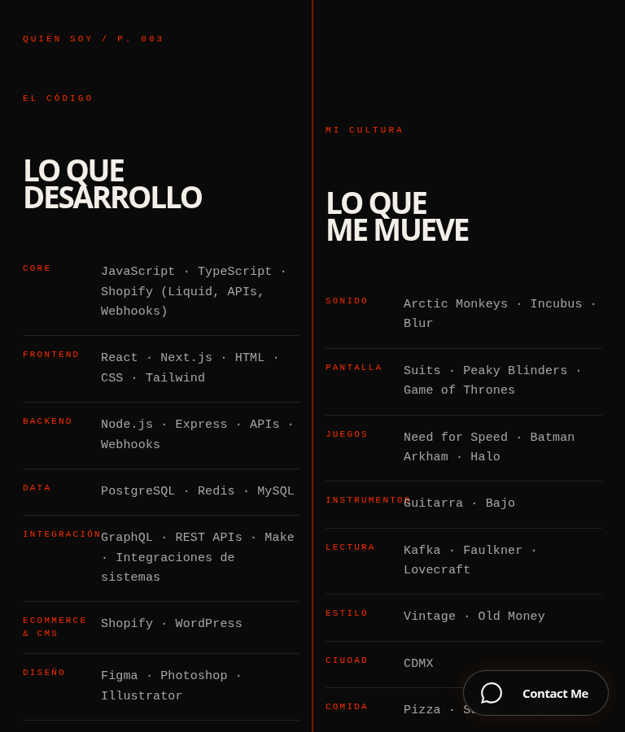
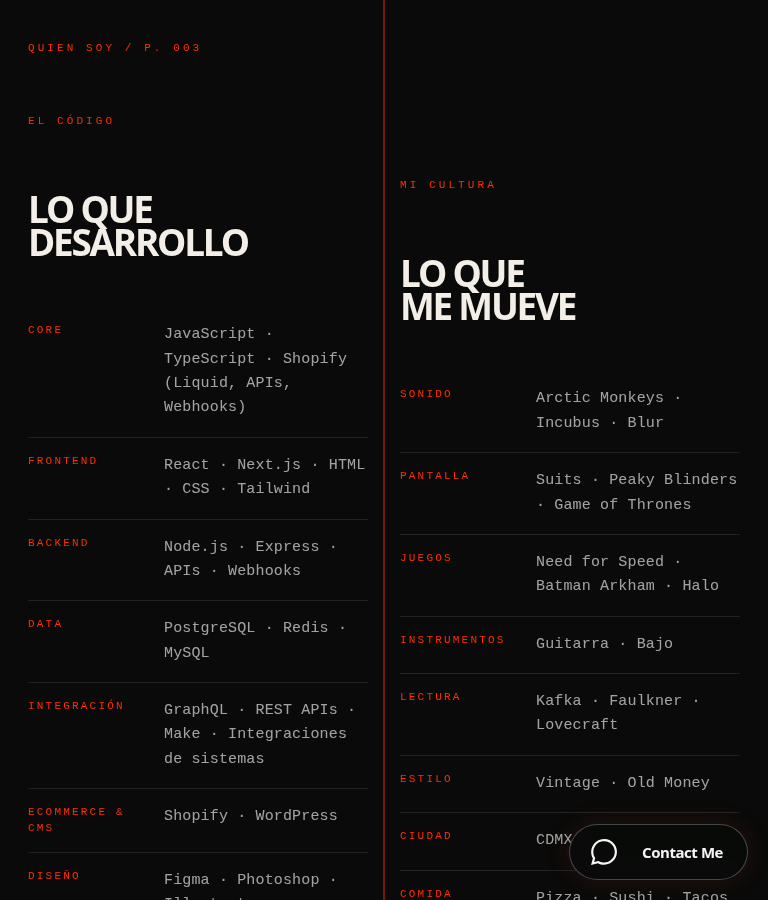

# Portfolio V2 — auditoría técnica, editorial y de experiencia

La implementación posterior, separada del PR #3 y basada en `2443026`, se documenta en [Portfolio V2 — implementación](PORTFOLIO_V2_IMPLEMENTATION.md). El inventario siguiente conserva el estado observado durante la auditoría; consultar ese informe para las funcionalidades aprobadas e incorporadas después.

## Alcance y base

Revisión del brief «PORTFOLIO V2 — Technical, Content & UX Evolution» contra los componentes y recursos reales de `Isaias-Web/isaiah-portfolio`. Rama nueva: `feat/portfolio-v2-audit`, desde `origin/main` en `eb4a8c4` (PR #2 integrado). `main` ya incluye la auditoría, HTML inicial/introReady, correcciones de Hooks y los ajustes de títulos tablet/Manifesto de los PR #1 y #2. Se leyeron `AGENTS.md`, `README.md` y `docs/TECHNICAL_AUDIT.md` antes de editar.

**Implementación de esta entrega:** corrección de las filas responsive de `WhoAmI.tsx`. El resto del documento son propuestas pendientes de revisión editorial/técnica. No se implementan nuevas secciones, animaciones, formulario, API de envío, proveedor de correo, credenciales ni servicios. No hay cambios de Vercel, merge o despliegue manual.

La corrección está aislada en `29c1acc` (`fix: prevent profile table label collisions across breakpoints`). Este documento y sus dos capturas de evidencia se guardan aparte para revisión.

La presencia de una afirmación en el código o en el CV permite inventariarla, pero no acredita autoría, resultados ni relación contractual con una marca. Se distingue entre: **observado** en código/navegador, **declarado** en contenido existente, **confirmado por el propietario** en esta conversación, **propuesto** para V2 y **por confirmar**. La confirmación del propietario no equivale a tener código o material institucional autorizado para mostrar. No se consultaron plataformas internas de UIC ni se incorporaron datos privados.

## 1. Corrección responsive implementada

### Causa y solución

`InfoTable` usaba etiquetas de 84 px y gap de 12 px entre 768 y 1279 px. Con fuente monoespaciada de 11 px y tracking de 0.2 em, `INSTRUMENTOS` ocupa aproximadamente 105.6 px: el texto invadía 9.6 px el área del valor. `INTEGRACIÓN` también excedía la columna. En móvil no siempre había colisión, pero las etiquetas seguían desbordando su caja.

Se sustituyeron los anchos contradictorios por `grid-cols-[7rem_minmax(0,1fr)]`, `gap-x-6` y `xl:gap-x-7`. Con raíz de 16 px son 112 px de etiqueta y gap de 24/28 px. `min-w-0` en fila y celdas, y `overflow-wrap:anywhere` solo en valores, permiten que el texto largo se ajuste sin imponer un ancho mínimo al grid.

No se reducen tamaño de letra, tracking o títulos; no se aumenta padding. Se mantienen el reparto exterior en dos columnas desde 768 px, la disposición apilada anterior a ese breakpoint y los ajustes de títulos integrados en el PR #2. Las celdas de valores conservan más de 200 px en el límite tablet probado, por lo que no hace falta añadir otra distribución a 768 px para resolver esta colisión. Un futuro contenido sensiblemente más largo deberá volver a comprobarse.

No se modifica Manifesto: sus cuatro títulos ya tienen margen izquierdo cero en la última versión de `main`. No se repite esa corrección. Tampoco se modifica el texto del manifiesto en esta entrega.

### Evidencia por ancho

Chromium/Playwright, con JavaScript y animaciones reales activas. Altura de viewport 844 px para 390; 900 px para los demás. Se midieron las 18 filas y los límites reales del texto con `Range`, se capturaron y revisaron imágenes de los nueve anchos y se comprobó que todos los títulos del Manifesto comparten el mismo borde izquierdo.

| Ancho | Separación mínima texto/valor antes | Después | Overflow de filas después | Manifesto | Pins |
| --- | ---: | ---: | --- | --- | ---: |
| 390 | 4.0 px | 40.0 px | Ninguno | Alineado | 3 |
| 767 | 12.0 px | 40.0 px | Ninguno | Alineado | 3 |
| 768 | −9.6 px | 30.4 px | Ninguno | Alineado | 3 |
| 771 | −9.6 px | 30.4 px | Ninguno | Alineado | 3 |
| 913 | −9.6 px | 30.4 px | Ninguno | Alineado | 3 |
| 1024 | −9.6 px | 30.4 px | Ninguno | Alineado | 3 |
| 1279 | −9.6 px | 30.4 px | Ninguno | Alineado | 3 |
| 1280 | 18.4 px | 34.4 px | Ninguno | Alineado | 3 |
| 1440 | 18.4 px | 34.4 px | Ninguno | Alineado | 3 |

La separación de la tabla es entre el último glifo de la etiqueta más larga y la caja del valor, no el gap CSS: este último es exactamente 24/28 px. No hubo overflow horizontal de página en estos tamaños. A 768 px la sección mide aproximadamente 1089.5 px y la última fila termina dentro de ella: no se ocultó contenido para hacer caber las tablas en el viewport. El salto de línea natural aumenta la altura móvil; el recorrido de scroll se vuelve a verificar abajo.

Comparación a 768 px, misma fase final del reveal (el resto de resoluciones está en las evidencias locales):

| Antes | Después |
| --- | --- |
|  |  |

## 2. Inventario editorial por sección

| Origen | Contenido y propósito actual | Hallazgos | Recomendación propuesta | Validación antes de publicar |
| --- | --- | --- | --- | --- |
| `src/sections/Hero.tsx` | Nombre gigante, retrato, dominio, «Full-Stack Developer & Digital Solutions Architect», «Desplázate para sintonizar» | La especialidad concreta depende de un descriptor largo en inglés; no ofrece acceso directo a proyectos/contacto | Descriptor breve en español y dos enlaces discretos de navegación; mantener nombre, retrato y composición | Confirmar título profesional y destinos; los anchors deben coordinar pins/Lenis, no añadirse ciegamente |
| `Manifesto.tsx` | Cuatro títulos y revelado por palabras, mensaje de perseverancia | «No lo haz hecho» debería ser «No lo has hecho»; la motivación no explica el trabajo profesional | Corregir el verbo tras aprobación; valorar un copy más propio sin aumentar líneas/palabras sin medir | El número de palabras fija el recorrido del pin (`totalSteps * 110`); cualquier reescritura requiere prueba de scroll |
| `WhoAmI.tsx` | Dos tablas: capacidades técnicas y cultura personal | «Quien soy» → «Quién soy»; mezcla tecnologías, herramientas y plataformas sin nivel/evidencia; UIC y PHP no figuran; IA no está en el HTML | Conservar el contraste código/cultura; ordenar especialidades con ejemplos, no acumular nombres | PHP/Python/Power Automate e IA confirmados por el propietario; aprobar su selección y copy antes de incorporarlos al sitio |
| `ProjectsRail.tsx` y paneles | Siete proyectos con introducción, categoría, imagen y apertura por click | Predomina eCommerce; se repiten «conversión», «claridad», «escalable» sin evidencia específica; secciones clicables carecen de acceso por teclado | Un problema y una contribución concreta por panel; convertir la apertura en control accesible en una tarea posterior | Autoría, alcance, cliente/colaboración y derechos para cada marca; comprobar interacciones tras cambios semánticos |
| `RightNow.tsx` | «PERFIL ACTUAL», cinco tarjetas y descriptor profesional repetido | Reitera Hero/WhoAmI; no identifica trabajo actual ni ejemplos de automatización | Reutilizarlo para experiencia actual y método de trabajo, manteniendo flujo natural y título editorial | Puesto/fecha ya confirmados; aprobar copy y ejemplos autorizados, y medir crecimiento vertical |
| `OpenChannel.tsx` | Frase de valor genérica, email, sitio/CV/GitHub/Instagram, footer | Email usa ellipsis; «Sitio» abre el mismo portfolio en otra pestaña; CTA no concreta el siguiente paso | «Cuéntame qué necesitas construir» y descripción de consultas; preservar email como alternativa al futuro formulario | Confirmar destinatario y canal preferente; decidir enlaces útiles y política de nuevas pestañas |
| `WhatsAppButton.tsx` | Enlace flotante con etiqueta «Contact Me», aria-label en español y tooltip | Idioma inconsistente; puede cubrir contenido de tablas en viewports pequeños y aparece por encima del shell | Proponer «Hablemos»/«Contactar» y revisar su área de exclusión; no moverlo sin pruebas | Confirmar número/canal; accesibilidad y tamaño del control |
| `src/app/layout.tsx` | Título, descripción, canonical, OG, Twitter y `es-MX` | Descriptor inglés duplicado; tarjeta sin imagen; título no refleja todavía contenido institucional/IA | Alinear metadata con copy aprobado y un OG propio real; mantener canonical/locale | La imagen debe existir y estar autorizada; no anticipar especialidades que aún no se documenten |
| `robots.ts`, `sitemap.ts` | Permite rastreo y publica solo la home canónica | Correctos para la arquitectura de una página | Mantener; añadir rutas solo si realmente se crean páginas de casos | Redirección www, cabeceras de preview e indexación en despliegue siguen pendientes; no se cambian aquí |
| `public/cv-isaias-frutos.pdf` | Trayectoria, roles, tecnologías, IA, enlaces y contacto | Conserva `isaiasfrutosweb.site`; declara «más de 6 empresas», «más de 25 proyectos» y «más de 50 sitios»; no se encontró UIC | Solicitar fuente editable y versión aprobada, actualizar dominio y coherencia de fechas; no trasladar cifras a la web sin soporte | Cifras/fechas vigentes, puesto actual, permiso de marcas y contenido del PDF; no se modifica el binario |
| `README.md` / `TECHNICAL_AUDIT.md` | Setup, flujo y registro de evolución | Algunas frases iniciales describen estados ya resueltos; el informe posterior los corrige, pero la lectura puede confundir | Mantener historial y añadir un resumen de estado actual en una tarea de documentación posterior | Distinguir resultados locales de checks remotos y mediciones de producción |

### Capacidades representadas y ausencias

Ya se declaran en WhoAmI: JavaScript, TypeScript, Shopify/Liquid/APIs/Webhooks, React, Next.js, HTML, CSS, Tailwind, Node.js, Express, PostgreSQL, Redis, MySQL, GraphQL, REST, Make, WordPress, Figma, Photoshop, Illustrator, GSAP, Three.js, Vercel, AWS y Docker. En este repositorio se observa directamente el uso de Next/React/TypeScript/Tailwind/GSAP/Lenis; eso no demuestra todas las tecnologías de proyectos externos.

El CV existente declara flujos con Make/Node y uso de IA para desarrollo, contenido y análisis. El propietario confirmó además uso de PHP y Python para scripts institucionales, Power Automate y ChatGPT/Codex para asistir al trabajo de ingeniería. Son capacidades confirmadas que aún no se explican en el HTML actual; no hay código institucional o ejemplos públicos adjuntos que permitan verificarlas técnicamente en este repositorio. No hay evidencia de entrenamiento de modelos, ML o agentes autónomos, y el propietario pide expresamente no atribuirse esas áreas. No añadir frameworks de agentes, cloud avanzado ni responsabilidad global de seguridad por inferencia.

Oportunidades de simplificación: sustituir repeticiones del título de Hero en RightNow por un rol actual confirmado; concentrar stacks compartidos sin repetirlos completos en panel/Story/Feature; distinguir especialidad, tecnología y herramienta; mantener la parte personal breve para que no compita con experiencia y contribuciones.

## 3. Inventario de los siete proyectos

Fuentes: los siete paneles en `src/components/projects/panels/`, `src/data/caseStudies.ts` y los tríos Hero/Story/Feature en `src/components/projects/case-studies/<slug>/`. Los textos y links siguientes son declaraciones existentes; no se contactó a las marcas ni se verificó el contenido remoto de sus sitios.

| Proyecto | Declaraciones actuales: propósito, año, rol/stack | Inconsistencias o contenido genérico | Propuesta y confirmación necesaria |
| --- | --- | --- | --- |
| TradeMate | B2B/B2C, inventario y órdenes; 2026; Full Stack/Ecommerce/System Design; Shopify/Liquid/GraphQL/Webhooks, Node, Redis/Upstash; link `trademat3.com` | Feature dice Shopify Plus y Story solo Shopify; «reducen errores», «escalar» y sincronización multi-tienda son resultados/capacidades sin evidencia adjunta | Explicar un flujo concreto y responsabilidad personal; confirmar plan Shopify, puesta en operación, arquitectura real y resultados antes de afirmarlos |
| TryFüm | DTC para México, producto y conversión; 2026; eCommerce/UX; Shopify, Liquid, JavaScript, CSS; `tryfum.com.mx` | Variantes TryFum/Tryfum/TryFüm/TRYFÜM; «mejores resultados de conversión» sin medida | Confirmar grafía de marca, relación de colaboración y alcance; describir cambios de navegación/producto sin atribuir uplift no medido |
| ONDA | Marca/wellness, storytelling y tienda; Shopify, Liquid, JS, CSS; `joinonda.com` | Hero indica 2026; Story y Feature 2025. Se repiten «premium», «emocionales», «conversión» y «EN OPERACIÓN» sin fecha de verificación | Resolver fecha con el propietario y separar intención visual de resultado comercial; concretar componentes o trabajo realizado |
| Sectra Visión | CMS/landings/CRM/analítica; 2024; webmaster/UX/desarrollo/marketing; WordPress, HTML, CSS, JS, Analytics, Tag Manager | Grafías SectraVision/Sectra Vision/Sectra Visión; link apunta a `omahacapitalprotegido.com.mx`, no al nombre del caso; se afirma seguridad/estabilidad | Confirmar relación entre el caso y ese sitio, rol exacto y herramientas; acotar seguridad a trabajo realmente realizado |
| Vape Mate | Catálogo, contenido y soporte visual; 2023; Shopify/Liquid/UX/JS/CSS/diseño/contenido | DTC en panel frente a distribución/operación en relato; Hero «Freelance & Fijo» poco preciso; «EN OPERACIÓN» pero Story muestra «Página no disponible» | Confirmar modalidad y mercado; cambiar estado a verificable y distinguir archivo de sitio activo. No fabricar un enlace alternativo |
| Hookah GT | Compra mayorista B2B, catálogo y marketing; 2023; webmaster/data entry/UX/creative; Shopify, Liquid, JS, CSS, diseño; `gthookah.com` | EE.UU./LATAM y beneficios operativos requieren precisión de participación; nombre del archivo contenedor de Hookah Partner sigue copiado de HookahGt | Describir entregables propios y confirmar alcance geográfico; renombrar componentes/copias técnicas en una tarea de mantenibilidad, sin añadir experiencia |
| Hookah Partner | DTC, colecciones y producto; 2023; WebMaster/data entry/UX/creative; stack similar a Hookah GT; `hookahpartner.com` | Relato y Feature reiteran conversión y claridad; grafía Webmaster/WebMaster inconsistente | Diferenciarlo del trabajo B2B por tarea concreta; confirmar resultados, autoría y derechos de material |

Propuesta de estructura de caso: **contexto → responsabilidad propia → intervención concreta → evidencia autorizada → estado/limitaciones**. Si no hay métricas, usar entregables verificables o una captura pública autorizada; nunca rellenar resultados con porcentajes estimados. No cambiar el orden del rail hasta decidir qué proyectos son más relevantes para el posicionamiento profesional.

## 4. UIC: experiencia confirmada y borrador para revisión

El propietario confirmó su puesto actual de **Web Master Institucional**, en **Comunicación Social de la Universidad Intercontinental**, con inicio el **18 de agosto de 2026**. No hay todavía una entrada UIC en los componentes ni en el CV. Autoriza preparar propuestas de esa experiencia, pero solicita revisarlas antes de implementar secciones o publicar contenido profesional. Los datos siguientes proceden de su confirmación; no se solicitaron contratos, credenciales ni documentación interna.

| Área | Confirmado por el propietario | Qué falta para un caso público |
| --- | --- | --- |
| Plataformas | Administración, mantenimiento y evolución del ecosistema institucional y sitios de programas académicos | Elegir material público y precisar contribución individual si se muestra un caso |
| Desarrollo | Landings, páginas, componentes y funcionalidades con WordPress, PHP, HTML, CSS y JavaScript | Seleccionar un ejemplo autorizado; no atribuir autoría completa de todos los sitios |
| Formularios | Integraciones de formularios con CRM/servicios, incluyendo Web-to-Lead y reCAPTCHA | Mantener en privado endpoints, identificadores y datos reales; no inferir un proveedor CRM |
| Incidencias | Diagnóstico, revisión de código y seguridad aplicativa dentro del alcance de su puesto | No generalizar a responsabilidad de ciberseguridad institucional ni describir vulnerabilidades |
| CMS | Gestión técnica de contenidos, plugins, estructuras y funcionalidades | Escoger entregables, sin publicar inventarios internos o versiones de infraestructura |
| Automatización | Scripts Python/PHP para cambios masivos, auditorías y validaciones; revisiones e inventarios | Ejemplo reconstruido con datos sintéticos o material expresamente autorizado |
| Coordinación | Atención técnica a distintas áreas y documentación de implementaciones | No publicar tickets, nombres o comunicaciones internas |

**Ubicación recomendada:** bloque de experiencia dentro de RightNow, antes de añadir una nueva sección o un octavo proyecto con pin. Presentarlo primero como contexto profesional; un caso de estudio se justifica solo si hay problema, contribución y material público autorizado. No publicar capturas privadas, datos de estudiantes, credenciales, topología, vulnerabilidades, identificadores o métricas confidenciales.

Borrador **pendiente de aprobación editorial, no implementado**:

> **Web Master Institucional — Universidad Intercontinental**  
> Comunicación Social · Agosto de 2026 – actualidad  
> Desarrollo y administro plataformas web institucionales, integro servicios y automatizo tareas técnicas en coordinación con distintas áreas.

Versión de tres bullets para el bloque de experiencia:

- Desarrollo y evolución de sitios, landings y funcionalidades con WordPress, PHP, HTML, CSS y JavaScript.
- Implementación y mantenimiento de formularios conectados a CRM y servicios externos.
- Scripts para actualizaciones, auditorías y validaciones, junto con documentación y coordinación técnica de solicitudes.

Detalle opcional para una versión extendida: «Diagnóstico de incidencias, revisión de código y seguridad aplicativa dentro del alcance de mi puesto». Conservar esa delimitación. No cambiar el puesto formal por «arquitecto institucional» o «ingeniero de IA».

No se redactan métricas ni resultados institucionales específicos. Un futuro campo de resultado debe ser un entregable público autorizado con contribución propia; si no existe material compartible, omitirlo. No convertir objetivos del equipo en logros personales.

## 5. IA y automatización: evidencia y copy propuesto

| Categoría | Estado de evidencia disponible | Tratamiento editorial |
| --- | --- | --- |
| Desarrollo asistido por IA | Propietario confirma ChatGPT/Codex para análisis, diagnóstico, planificación, refactorización, documentación, desarrollo, pruebas y revisión con GitHub/CI/Vercel | Práctica actual de ingeniería asistida; describir revisión y comprobaciones sin atribuir generación autónoma de sistemas |
| Automatización técnica | Propietario confirma scripts Python/PHP para actualizaciones, auditorías, validaciones e inventarios de múltiples páginas | Implementación confirmada por el autor; falta un ejemplo publicable con datos sintéticos o autorizados |
| Automatización operativa | Propietario confirma flujos Power Automate que procesan correos y adjuntos bajo condiciones y evitan duplicados | Explicar el patrón genérico y sus controles sin publicar buzones, condiciones institucionales o datos de archivos |
| Integraciones | Formularios/CRM/Web-to-Lead/reCAPTCHA confirmados en UIC; Make/Node/API declarados en CV; resultados de TradeMate aún por corroborar | Separar integración realizada de impacto no medido y de la relación con otros proyectos |
| Refactorización/análisis del portfolio | Historial de cambios y validaciones verificable en este repositorio; propietario confirma uso de IA en ese flujo | Ejemplo personal publicable tras aprobar el relato; no presentarlo como proyecto institucional o encargo a cliente |
| ML, entrenamiento o agentes autónomos | Sin evidencia en los archivos revisados | No incluir como experiencia |

Borrador de posicionamiento general, pendiente de aprobación:

> **Desarrollo full-stack, eCommerce e integraciones.**  
> Construyo plataformas web y conecto servicios para resolver necesidades de operación digital.

Borrador de categoría elegido con el propietario, pendiente de aprobación editorial:

> **AI-Assisted Engineering & Automation**  
> Integro herramientas de IA en el análisis, desarrollo y revisión de software. Automatizo tareas técnicas con Python y PHP y procesos operativos con Power Automate, con validaciones y control de duplicados según cada flujo.

Tres notas breves propuestas para explicar el trabajo:

- **Ingeniería asistida:** ChatGPT y Codex como apoyo para analizar, planificar, refactorizar y documentar; cambios revisados mediante pruebas y control de versiones.
- **Automatización técnica:** scripts para actualizaciones, inventarios, auditorías y validaciones de páginas.
- **Automatización operativa:** procesamiento condicionado de correos y adjuntos con Power Automate, incluyendo prevención de duplicados.

Como ejemplo visual, usar «tarea → intervención → validación» y una pequeña muestra reconstruida con datos sintéticos, no una captura de sistemas internos. El portfolio puede ilustrar la ingeniería asistida con su propio historial técnico.

Una afirmación sobre eficiencia debe acompañarse de evidencia o redactarse como objetivo. No prometer ahorro de tiempo, mayor conversión, autonomía o capacidad de entrenamiento. Distinguir **implementaciones confirmadas por el autor** (UIC, scripts y flujos), **proyecto personal verificable aquí** (portfolio) y **capacidades en desarrollo**. El propietario no enumeró nuevas capacidades en desarrollo: no inventarlas ni colocar lo ya implementado bajo «En exploración». La etiqueta solo se usará cuando él identifique una práctica aún en formación. No existe aún un artefacto público adjunto para los flujos institucionales.

## 6. Arquitectura editorial y propuesta visual

Mantener las seis secciones y los tokens existentes: fondo `#090a09`, acento `#ff2d00`, títulos expresivos y metadatos monoespaciados. Propuesta conceptual, sin nuevos componentes implementados:

| Sección | Responsabilidad editorial V2 | Reutilización y componente futuro | Impacto a comprobar |
| --- | --- | --- | --- |
| Hero | Identidad, especialidad y acceso a contenido | Mantener Hero; añadir navegación discreta accesible solo tras revisar offsets | Posición de anchors con pins/Lenis, foco y móvil; sin cambiar timeline |
| Manifesto | Una idea de trabajo propia | Mantener RevealLine y cuatro líneas hasta aprobar copy | Número de palabras y longitud definen duración espacial del pin |
| WhoAmI | Capacidades seleccionadas y personalidad | Mantener InfoTable; actualizar valores solo con evidencia | Añadir filas modifica la secuencia y su relación con el end fijo de 1400 px: no hacerlo automáticamente |
| ProjectsRail | Evidencia de contribuciones | Mantener siete paneles; posible fuente común `CaseStudyRecord` para año, rol, stack y estado | Evitar divergencias Hero/Story/Feature; separar migración de datos de cualquier cambio visual |
| RightNow | Experiencia actual y forma de trabajar | Reutilizar la zona «ACTUALMENTE» para `ExperienceSummary` y `PracticeNote`, sin pin nuevo | Crece altura natural después del rail; medir posición de contacto, refresh y lectura móvil |
| OpenChannel | Una acción clara y canales alternativos | Mantener email/WhatsApp; propuesta `ContactForm` aislada de las animaciones | Altura, teclado virtual móvil, estados de error y contacto sin JS |

Wireframe editorial propuesto para la parte reutilizada de RightNow:

```text
PERFIL ACTUAL                   [título existente]
───────────────────────────────────────────────
/ EXPERIENCIA                   / MÉTODO
UIC                             INGENIERÍA ASISTIDA Y AUTOMATIZACIÓN
Web Master Institucional        [estado de evidencia del ejemplo]
Agosto 2026 – actualidad         [ejemplo seleccionado]
[2–3 tareas verificadas]         [tarea → revisión → comprobación]
[evidencia autorizada, si existe]
```

En escritorio, dos bloques alineados sobre el mismo ritmo de líneas, con acento naranja solo en labels; en móvil, experiencia seguida de método, ambos en flujo natural. Evitar badges de tecnologías dominando la composición, porcentajes de habilidad, nuevos fondos o una «sección IA» genérica. UIC y las prácticas están confirmadas por el propietario, pero su copy y composición final todavía requieren su revisión antes de publicarse.

Jerarquía de navegación propuesta: **Perfil / Proyectos / Experiencia / Contacto**, mediante enlaces semánticos. Un anchor no equivale a una posición visual útil dentro de secciones fijadas: diseñar su integración con los starts de ScrollTrigger, foco y retorno desde overlays antes de implementarlo. No proponer nuevos pins como mecanismo de navegación.

## 7. Formulario dentro de OpenChannel, solo propuesta

Copy de entrada: **«Cuéntame qué necesitas construir»**. Apoyo propuesto: «Desarrollo web, eCommerce, integraciones o una colaboración. Describe el contexto y el objetivo de tu consulta». CTA: **«Enviar consulta»**. No prometer tiempos de respuesta sin acordarlos. El email actual sigue como alternativa; confirmar destinatario en lugar de inferir que deba ser el mismo.

```text
/ CONTACTO
Cuéntame qué necesitas construir
[Nombre                     ] [Correo                    ]
[Tipo de consulta                                        ]
[Mensaje                                                 ]
[Uso de datos y enlace de privacidad aprobado             ]
[Enviar consulta]              [O escríbeme por correo]
```

La propuesta de correo de esta auditoría fue sustituida por Web3Forms. Ver [configuración vigente](CONTACT_DELIVERY_SETUP.md).

La configuración, privacidad, protección del proveedor, validación y pruebas vigentes se documentan en [CONTACT_DELIVERY_SETUP.md](CONTACT_DELIVERY_SETUP.md). La propuesta de backend propio queda retirada.

## 8. Auditoría técnica complementaria y prioridades

| Prioridad | Evidencia actual | Siguiente trabajo recomendado | Criterio de aceptación |
| --- | --- | --- | --- |
| P0 | Colisiones reproducidas y corregidas en WhoAmI | Revisar este diff y las nueve resoluciones | Sin colisiones/overflow de filas y sin regresión de pins/scroll |
| P1 | Año ONDA divergente, estado Vape Mate ambiguo, CV con dominio antiguo | Confirmar datos, fuente del CV y copy | Un único año/estado por caso, dominio correcto en PDF, sin resultados inventados |
| P1 | Puesto, período y tareas UIC/IA/automatización confirmados por el propietario; copy y material público no aprobados todavía | Revisar estos borradores y seleccionar evidencia compartible | Copy aprobado y materiales autorizados antes de implementar o publicar |
| P1 | Siete paneles son `section onClick` sin role/tabIndex; se observan ocho H1 en home; shell sin semántica de diálogo ni gestión explícita de foco | Diseñar controles semánticos, jerarquía de headings, foco/restauración y diálogo | Todo proyecto se abre con teclado, foco estable al navegar/cerrar y lector de pantalla orientado |
| P1 | Movimiento reducido no altera actualmente las timelines; cursor oculto globalmente desde 768 px, incluidos controles | Propuesta específica de reduced motion y cursor según puntero fino/foco | Lectura y navegación disponibles sin movimientos innecesarios; preservar experiencia principal tras revisión |
| P1 | Advertencia previa de hidratación en el `className` multilínea del email de OpenChannel | Reproducir en desarrollo y normalizar markup en un commit separado si se confirma | Sin warning de hidratación y misma apariencia; no usar suppressHydrationWarning como solución |
| P2 | 21 advertencias `no-img-element`; assets fuente aproximados: ONDA PNG 2.4 MB, retrato PNG 2 MB, Sectra PNG 1.6 MB | Medir requests y recorte por viewport; optimizar un grupo de imágenes por vez, con tamaños/sizes y estrategia de carga justificados | Comparación visual y transferencia real antes/después; no asumir que peso de origen sea peso servido por next/image |
| P2 | Lighthouse no instalado ni ejecutado en esta entrega; sin datos de campo LCP/INP/CLS | Baseline local/preview en móvil y desktop, varias corridas; medir inicio/cierre de overlays y carga fría con fuentes/imágenes | Informe reproducible de laboratorio separado de datos de campo; ninguna puntuación inventada |
| P2 | SEO básico correcto; canonical/es-MX observados; OG sin imagen; los casos solo se montan en overlay, sin ruta propia | OG con asset autorizado; evaluar páginas de casos solo si aportan contenido rastreable y mantienen la experiencia | HTML útil y metadata consistente; JSON-LD Person/CreativeWork solo con datos verificables |
| P2 | Años/stacks/textos duplicados entre panel, Hero, Story y Feature; HookahPartner conserva nombre interno copiado de HookahGt | Contrato tipado de datos y nombres claros, sin generalizar prematuramente todos los layouts | Un origen para hechos editoriales y mismo comportamiento de cada caso |
| P3 | SVGs de plantilla y una imagen de Nissan sin referencia encontrada en `src` | Revisar usos externos/documentación antes de limpiar assets | Solo retirar recursos cuya ausencia no afecte ningún flujo |

No se medirán mejoras por una puntuación teórica. La corrección responsive se sustenta en geometría reproducida y comparación visual; las optimizaciones de rendimiento permanecen como hipótesis hasta medir transferencia, layout y respuesta real a interacciones.

## 9. Validación de la entrega y límites

| Comprobación | Resultado |
| --- | --- |
| `npm run build` sobre main actualizado, antes del ajuste | Código 0 |
| `npm run lint` después | Código 0; 0 errores y 21 advertencias preexistentes de imágenes |
| `npx tsc --noEmit` | Código 0 |
| `npm run build` después | Código 0; home, not-found, robots y sitemap estáticos |
| `git diff --check` | Código 0 |
| Responsive Chromium | Nueve anchos, 18 filas sin colisiones/overflow, Manifesto alineado y tres pins en todos |
| Regresión desktop/móvil | Siete reveals y casos; apertura, cierre, ráfaga de navegación, Escape repetido, resize con overlay abierto y dentro del rail; sin errores de página |
| Scroll | Scroll interno sin mover fondo; cierre devuelve Lenis; rueda de 500 px produce 450 px con el multiplicador existente |

En la regresión el documento mide 16859 px en desktop 1440×900 y 11273 px en móvil 390×844. El crecimiento móvil frente a los 11180 px de la auditoría anterior responde al ajuste natural de los textos en columnas; no se alteran distancias de triggers, scrub, duraciones o easing. Los hooks y timelines no forman parte del diff.

Se usó Chromium local y emulación de viewport contra `next start` en puertos 3120 (referencia) y 3121 (resultado). Scripts, JSON, capturas antes/después y logs en `/workspace/work/portfolio-v2/`, incluido `regression/`. Los PNG de los nueve anchos se inspeccionaron visualmente; también se midieron todos los glifos/celdas para cubrir filas fuera del viewport. No hay puntuaciones Lighthouse ni Web Vitals reales en este informe.

Pendientes: Safari/iOS/Firefox, táctil real, zoom/fuentes del usuario, lector de pantalla y teclado integral; revisar el botón flotante que puede superponerse a filas visibles. No se repiten pruebas de red o fallos del preloader, ya cubiertas anteriormente; las recomendaciones editoriales y del formulario no son funcionalidades implementadas. No se comprobó uptime de los enlaces externos, relaciones con marcas, redirecciones de producción o cuentas de correo.

La entrega para PR en borrador contiene `WhoAmI.tsx`, este informe y dos PNG de evidencia en `docs/assets/portfolio-v2/`. El resto requiere aprobación editorial/técnica posterior. No se fusiona a main, no se despliega manualmente ni se cambia Vercel; el push puede activar el Preview automático existente.
