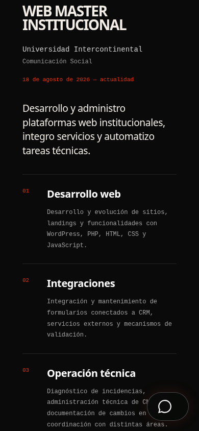
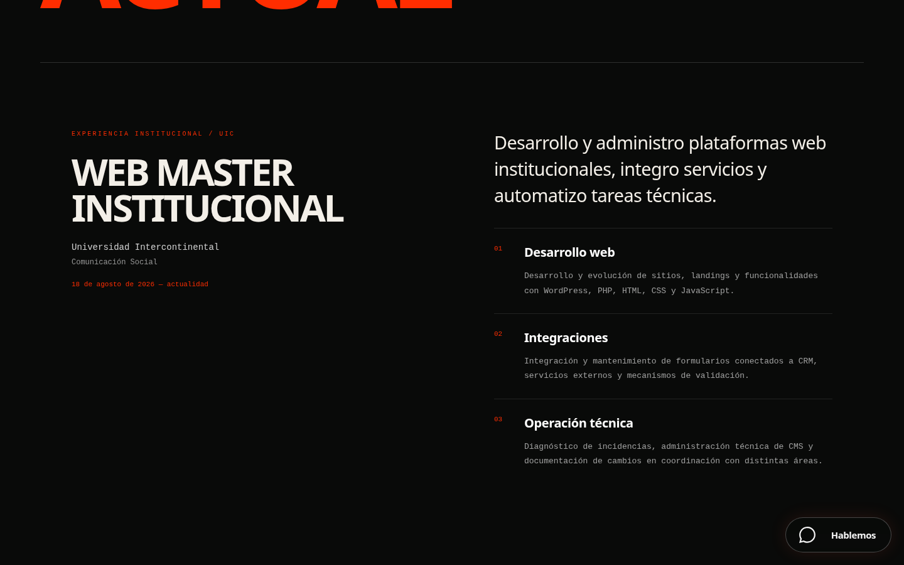

# Evidencia local de auditoría

Ver [informe](../../PORTFOLIO_V2_PERFORMANCE_AUDIT.md) para método, alcance, limitaciones y comandos. Los JSON contienen métricas/resultados, sin claves o contenido de consultas reales.

- [results.json](results.json): Lighthouse, nueve anchos, axe, teclado, rail, preloader, SEO, mocks y análisis de dependencias.
- [micro.json](micro.json): conteos específicos antes/después y los 61 estados de palabras; la instrumentación temporal no se publica en la aplicación.

Capturas de RightNow tomadas después de la entrada de los elementos, con scroll y viewport equivalentes. Ambas parejas tienen cero diferencias de canales. Representan ese estado, no todos los frames de una animación ni un dispositivo físico.

| Ancho   | Antes (`155e028`)                                | Después                                           |
| ------- | ------------------------------------------------ | ------------------------------------------------- |
| 390 px  |        |        |
| 1440 px |  |  |
