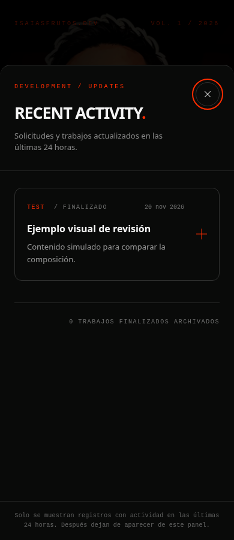
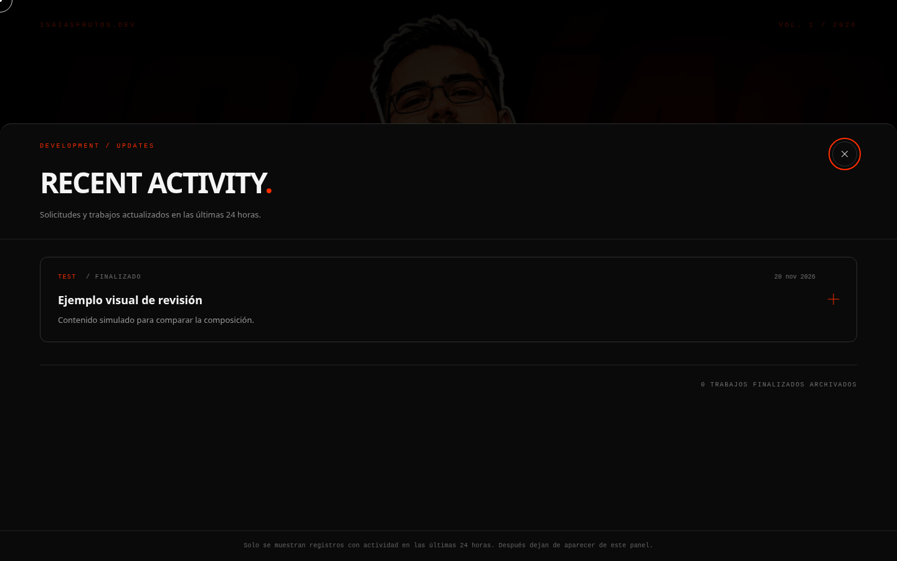

# Evidencia — Recent Activity, Fase 1

Ver el [informe técnico](../../RECENT_ACTIVITY_ACCESSIBILITY.md) para comandos, alcance y limitaciones. Los registros son mocks locales; no se publicaron actividades.

[Resultados](results.json): navegador, geometría, comparación de capturas, formulario simulado y recuperación del preloader. Las capturas no son idénticas píxel a píxel; los rectángulos medidos se conservan en los cuatro anchos. Comparación de estados asentados, no de todos los frames.

| Ancho   | Antes (`ec6eab4`)                                   | Después                                              |
| ------- | --------------------------------------------------- | ---------------------------------------------------- |
| 390 px  |        |        |
| 1440 px |  |  |
